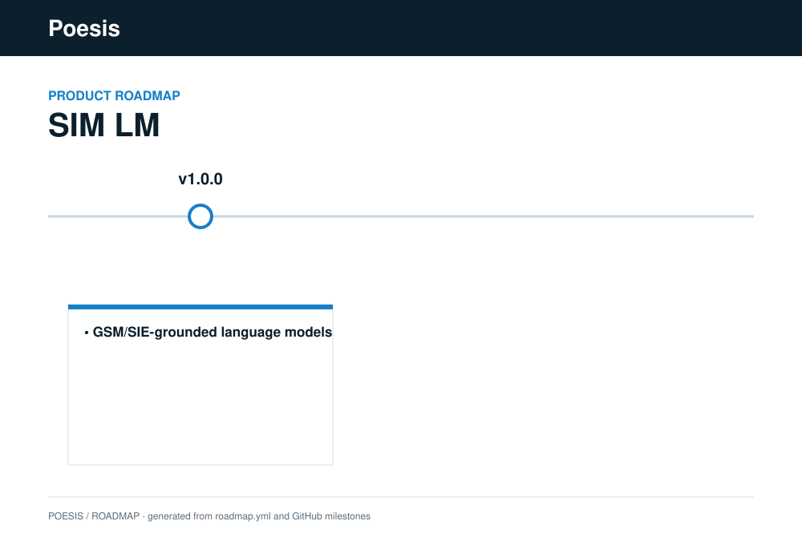

# SIM LM

The language model of **SIM (Systemic Intelligence Model)**, a solution of the Poesis platform.

## License

Business Source License 1.1 (BUSL-1.1) — see [`LICENSE`](LICENSE). Trademarks: see [`TRADEMARK.md`](TRADEMARK.md).

<!-- roadmap:start -->
## Roadmap

<!-- roadmap:end -->
